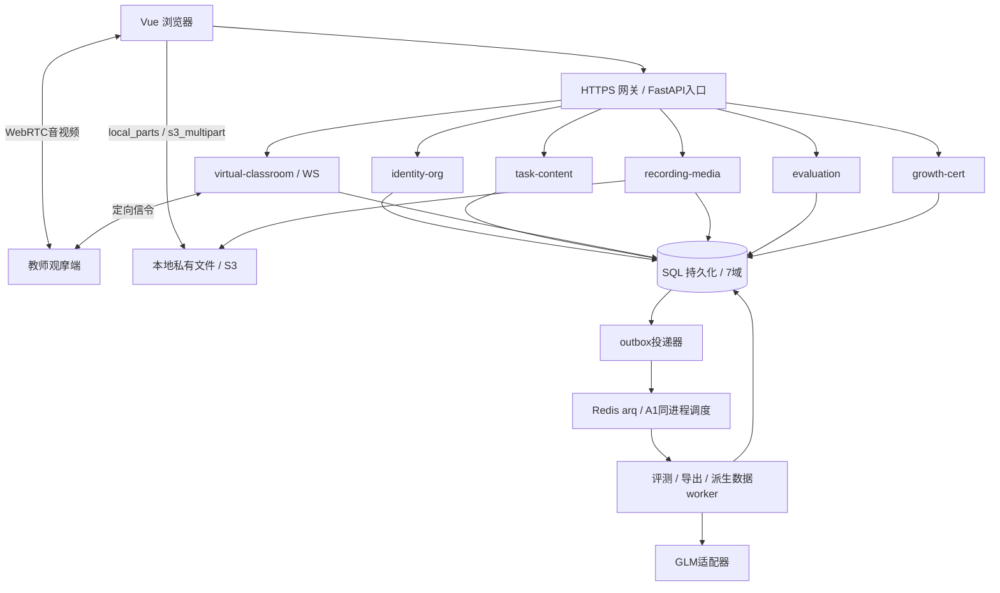
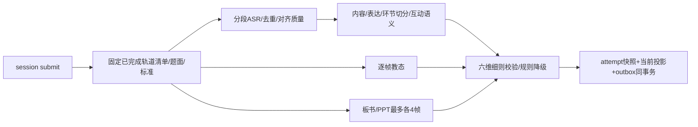

# 师范专业 AI 试讲台系统 — 系统概要设计（HLD）

| 文档信息 | 内容 |
|---|---|
| 文档版本 | 3.2.0（设计文档 3.x） |
| 修订日期 | 2026-10-28 |
| 文档职责 | 架构、服务边界与依赖图 |
| 修订依据 | 本目录 01、05、06、11、12；工程实施按 ADR-010/011/012；旧版已清理 |
| 本版变更 | 统一生命周期、评分、媒体、权限与部署契约；具体映射见 12-修订追踪与验收门禁 |
| 状态 | 设计修订完成；应用开发、DDL 生成与数据库实跑、模型效果和性能验收仍须过门禁 |

## 1 架构与部署边界

保持六个限界上下文；A1可作为一个FastAPI进程内的独立模块，生产可独立进程。单SQL实例允许跨schema物理FK，不等于允许服务任意跨域写。跨域查询走内部接口或版本化事件，统计用growth域投影，不做跨服务在线JOIN。没有新增RabbitMQ/Kafka或Celery强依赖。

## 2 服务职责

| 服务 | 数据所有权 | 入口与副作用 |
|---|---|---|
| identity-org | user、department、档案、班级、consent、security_session | 认证、权限版本校验、院系/班级范围、收权和改密 |
| task-content | task、rubric版本、细则、题库、模板、范例 | 发布前校验；向场次提供immutable配置快照 |
| virtual-classroom | session、time_span、virtual_student、session_event、行为/消息事实 | start原子限制活动场次/重做；权威活动时间；WS有序流和WebRTC信令 |
| recording-media | recording、media_upload、media_upload_part、marker、observation | 分片协议、checksum、转码、私有回放；授权校验 |
| evaluation | report、evaluation_attempt、当前维度/指标/问题/建议、teacher_review | DAG、评分、不可变尝试、人工主批、成绩版本 |
| growth-cert | training、exam、stats、leaderboard、certificate、progress、weakness | 服务端可信评分、派生聚合、证书复核 |
| platform横切 | outbox_event、consumer_receipt、export_task、audit_log | 事件投递与幂等、导出、审计 |

## 3 ADR

| 编号 | 决策 | 原因与限制 |
|---|---|---|
| ADR-001 | Python3.12+FastAPI+Pydantic2 | API/WS统一，DTO导出；FFmpeg使用子进程并限制并发 |
| ADR-002 | SQLAlchemy2+Alembic，MySQL8/SQL Server双方言 | 模型声明schema；数据库必须同实例；统一迁移依赖图，按方言生成DDL |
| ADR-003 | A1 SQL待办+同进程调度；A2/B arq+Redis | 业务任务先落SQL/outbox；重启补投，队列不是唯一事实源；不宣称原样切换无需worker配置 |
| ADR-004 | WS控制/信令，WebRTC媒体 | 每场1学生+最多4观摩，生产TURN；媒体与控制限流分离 |
| ADR-005 | session_event持久化后广播 | 序号/快照/重放可恢复；事务失败不广播，Pub/Sub只作通知 |
| ADR-006 | StorageAdapter统一私有对象 | local_parts服务端分片落盘与s3_multipart；URL续签，持久化清单 |
| ADR-007 | AI请求按模型全局限流 | API配额与评测并发是不同资源；多worker用Redis租约/令牌桶，A1共享进程限流器 |
| ADR-008 | current report + immutable attempt snapshot | 重算成功再切换，失败保留旧结果，人工分不被AI重算抹掉 |
| ADR-009 | SQL outbox+幂等消费 | 提交与发事件不再双写丢失；允许重放、乱序版本保护 |

## 4 数据架构和连接

7域：identity_org/task_content/classroom/media/evaluation/growth_cert/platform。MySQL为7个database；SQL Server为同一ai_teach数据库中的7个schema。单engine可带默认库，只要全部模型显式声明schema且账户具有访问权限；无需通过“删库名”实现跨库。schema_translate_map仅用于物理库名映射，不能把7个旧库自动合并为单库。多engine不会关闭数据库FK，但不能形成同一个本地跨engine事务。

本版保持同实例；跨域外键按05管理。分服务部署仍各自拥有写边界，跨域副作用交给outbox。未来跨实例拆库是架构变更，需要移除对应物理FK并实现事件校验，不能仅改DSN。

目标61表：原52表修正+department/security_session/media_upload/media_upload_part/evaluation_attempt/outbox_event/consumer_receipt/session_event/session_time_span九表。旧生成器尚未适配本版，G1验收前不能直接覆盖新文档。

## 5 场次、媒体与实时恢复

start锁定user行，校验无running/paused、任务未截止、已开始次数<1+allow_retry；绑定模式/时长/指定题与rubric快照，编号attempt_no从1递增。后台概率引擎每秒更新，脚本调度独立按活动时间到期，目标±200ms。

pause关闭当前time_span并暂停所有MediaRecorder与WebRTC媒体发送，resume新开span；活动offset为闭合span时长+当前span时长。绝对created_at不代替活动offset。跨实例漂移使用UTC/NTP并观测，不用Redis INCR计数当时钟。

业务事件写session_event并分配next_seq，同事务写行为/消息事实和当前快照版本，提交后广播。重连若requested_seq在7天保留窗口内，先按seq重放至high_water_seq，再进入实时；否则发送完整snapshot(reset=true, high_water_seq)，客户端重置去重游标。Redis重启不把序号归1。瞬态timer/pong和WebRTC信令没有seq，不进入重放。

观摩前创建observation并申请短期WS票据；定向webrtc.offer/answer/ice在WS转发，绑定peer_id和observation_id，禁止信令广播给整场。TURN凭据短时签发。观摩第5人返回409 observer-capacity；媒体失败可继续文字指导，UI明确音视频中断。

## 6 评测DAG

事件计数可以先算，但候答/问句/反馈必须等待ASR。视觉采用每15秒一帧、每场最多180帧（45分钟）；10分钟约40帧。逐帧独立请求，不混用“五批多图”和“每帧一次”。静态教态不推断帧间走动；movement_score=NULL，相关细则由human评分或缺失重归一。

分段ASR每段最多25秒、1秒重叠、单文件不超过20MiB的保守输入上限；实际适配器限制可更严，需记录能力清单。逐段先去重再拼全局偏移。provider原生句/词时间戳经样本校验后标verified；没有对齐能力则标approximate，不伪造时间点或口头禅精确offset。生产证据验收必须通过G3。

首次结果不满足≥4可用维度或可用权重和=0则partial无总分；初次系统错误则failed；新尝试失败/partial不会取代现有成功快照。满六维且verified才可用于正式考核及证书。

## 7 安全与授权

JWT access 2小时，refresh 7天轮换；每次HTTP/WS业务写入校验user.status、auth_version、security_session.revoked_at。API读请求也不能只信旧JWT权限。退出撤销session；改密、停用、收权提高auth_version并撤销受影响session。内网接口用服务凭据，网关删除用户伪造的X-Scope头，服务自己执行资源归属校验。

院系由department_id、class.department_id与major.department_id确定；角色创建/范围变更不能超出操作者范围。下载、媒体play-url、上传及WS票据均先鉴权，不公开挂载媒体目录。第三方云分析必须有效analysis授权；撤回后取消未发送请求，已在供应商处理中无法撤回的数据标注并禁止继续调度。

## 8 一致性与恢复

报告发布、人工主批/改分/退回均锁定同一report行，重新计算final_score/grade并递增score_version，与score.changed outbox同事务。growth消费记录(consumer,event_id)，按report_id最新版本覆盖、重新聚合受影响周期，默认60秒内完成。重试不可重复累加计数。

证书保存佐证attempt_id+report_id+score_version+规则快照。降分或依据改变进入pending_review，valid=false，人工确认后保留或撤销，所有决定追加审计。评测失败不会凭空抹去旧有效结果。

## 9 技术风险与验证

G1新库/升级与FK级联、G2真实录制上传、G3模型/时间对齐、G4越权/重启/改分、G5效果、G6容量详见12。模型标识可替换不代表能力等价；所有模型或提示词变更回归固定样本。配额限制时排队，600秒阈值以submit接受时间计算，不能无限延迟后仍声称5分钟达成。
