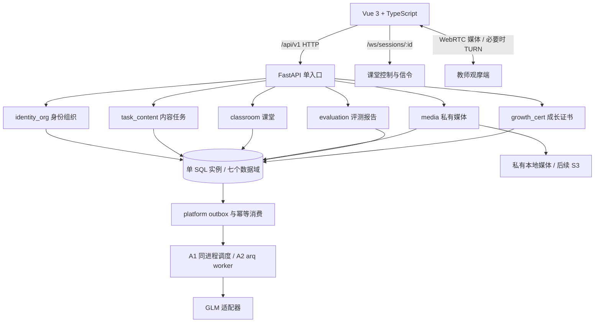

# 师范专业 AI 试讲台系统：六人团队从零开发执行方案

| 项目 | 内容 |
|---|---|
| 指南版本 | 1.0.0 |
| 编制日期 | 2026-10-27 |
| 适用设计基线 | 上级目录 `设计文档3.x/` 的 3.2.0；需求/数据库/API/DTO 分别以 01/05/06/11 为准 |
| 适用对象 | 尚未编写业务代码的六人开发小组 |
| 本文职责 | 明确分工、工程文件、实现顺序、验证命令、预期结果和集成验收办法 |
| 当前状态 | 开发执行指南；文中的目标代码、脚本与测试须按步骤实现，不能视为已存在或已通过 |

> 本文只把设计转化为可执行的开发任务，不重定义数据库字段、DTO、权限或评分公式。设计出现冲突，登记问题并提交 ADR，评审后同步 01/05/06/11、迁移和测试。不要从旧 DDL 或旧部署壳推断 3.2.0 已实现。

## 阅读入口

- 整体架构与分工：第 1–3 节。
- 从空工程到真实闭环：第 4 节，依次执行步骤 0–13。
- 分支、模块交付和联调：第 5–7 节。
- 门禁、验收与故障定位：第 8–10 节。
- 可直接认领的任务与交接模板：配套 [14-六人成员任务卡与联调清单.md](14-六人成员任务卡与联调清单.md)。

## 1. 先统一目标：分三次跑通

### 1.1 三个里程碑

| 里程碑 | 必须跑通的内容 | 可以证明什么 | 不能据此宣称什么 |
|---|---|---|---|
| M0 工程与契约可运行 | 干净依赖安装、目标数据库、健康检查、DTO、登录与权限、发布标准/任务 | 工程和基础契约可实现 | 真实录制、AI 效果、完整产品可用 |
| M1 最短真实纵向闭环 | 授权→任务→真实录制→finish→末片等待→逐轨 complete→显式 submit→真实评测→报告→教师主批→统计/导出 | 核心链路在记录的环境与样本下成立 | 全部 P0/P1、双机容量、200 场并发或模型效果达标 |
| M2 完整版本交付 | 全部 P0，随后全部 P1；安全、恢复、效果、容量、运维与四角色 UAT | 对应版本和适用门禁达标 | 未测硬件、网络、供应商或负载下的能力 |

先用短素材迭代组件；按 11 号契约，正常正式录制至少 5 分钟，不足该要求的异常片段可封存回看，但不能正式 submit 评分；M1/G2 必须补真实 10 分钟新录制。10 秒模型连通不代替长音频和效果验收。`rules`/`cached_demo` 可供界面、异常和调度开发，但必须显著标识，不给假总分，不计作真实 AI 闭环通过。

### 1.2 事实源和现存文件

| 事项 | 事实源/处理原则 |
|---|---|
| 需求和 P0/P1 范围 | [01-需求规格说明书-SRS.md](../01-需求规格说明书-SRS.md)、[02-产品需求文档-PRD.md](../02-产品需求文档-PRD.md) |
| 架构与事务 | [03-系统概要设计-HLD.md](../03-系统概要设计-HLD.md)、[04-详细设计-LLD.md](../04-详细设计-LLD.md) |
| 目标数据库 | [05-数据库设计文档-V2.md](../05-数据库设计文档-V2.md)，目标 61 表；名称中的 V2 不代表内容仍是旧版 |
| HTTP/WS 与字段 | [06-接口设计文档.md](../06-接口设计文档.md)、[11-实现契约.md](../11-实现契约.md) |
| 页面、测试、部署 | 07、08、09、10 号设计文档 |
| 放行标准 | [12-修订追踪与验收门禁.md](../12-修订追踪与验收门禁.md)，G1–G6 均须实际证据 |
| 历史输入 | 过时设计、字典和报告已清理；仅支持全新 61 表数据库；取消旧 52 表升级、历史数据导入和兼容验收，历史 SQL/模型/生成数据不再是开发输入 |
| `app/deploy/` | 统一 Python3.12、Linux锁包和 frontend/dist；预检通过不等于完整业务或G门禁通过 |
| 文档维护 | 旧生成链已删除；直接维护本版正文和机器契约。只读校验见最短链路验证/check_design.py；13/14为本基准实施展开，不构成第二套方案 |

## 2. 整体架构、模块与技术栈

### 2.1 第一版采用模块化单体

六人先维护同一仓库、一个后端工程、一个 Vue 工程和同一套迁移。模块按业务域分开，A1 以一个 FastAPI 进程运行。不要一开始拆成六套独立部署和六套鉴权；可独立进程部署是后续形态，数据所有权边界从第一天遵守。



关键限制：

1. API→service→repository→model；router 不直接堆业务事务，DTO 不直接返回 ORM 对象。
2. 六个业务域和 `platform` 横切域共七域；A1 单实例内允许设计要求的跨 schema FK，不允许其他域随意写它的表。
3. 仅 MySQL，用同一实例内七个 database、统一 InnoDB。不能把七个独立数据库服务器当成一个本地事务。
4. 所有外部入口有权限及资源范围校验；媒体不挂成公开 `StaticFiles`，AI 密钥不放前端。
5. `finish`、媒体 `complete`、`session submit` 分离；只有最后一步领取评测尝试。
6. SQL 是任务和事件事实源；A1 的内存只是唤醒/临时运行态，重启需从 SQL 恢复。A1 只运行一个 API worker，录制中不使用 `--reload`。
7. WS 传控制事件与 RTC 信令；WebRTC 传实时音视频。上传录像不等于实时观摩。

### 2.2 技术栈冻结建议

| 层 | 本项目选择 | 第一阶段用途/限制 |
|---|---|---|
| 后端解释器 | Python 3.12 x64 | 默认 `python` 指向别的版本时，使用明确路径或 `py -3.12` |
| API/DTO | FastAPI、Pydantic 2、pydantic-settings、Uvicorn | HTTP/WS、Settings、OpenAPI；安装后锁定完整依赖版本 |
| 数据访问 | SQLAlchemy 2、Alembic | 一个 metadata/迁移依赖图；仅实现MySQL |
| MySQL 驱动 | PyMySQL，采用同步 SQLAlchemy Session | 唯一数据库为 MySQL 8；从同步路由进入同步 DB 工作，不在 async WS 协程内阻塞查询 |
| 前端 | Vue 3、TypeScript、Vite、Vue Router、Pinia、ECharts | 选工程版作为六人唯一维护的正式 UI；不重复维护另一套零构建业务页面 |
| 媒体 | 浏览器 MediaRecorder、IndexedDB、WebRTC；FFmpeg/FFprobe 子进程 | 原始轨道与分片、私有回放、转码/探测；FFmpeg 默认并发 1 |
| AI | 设计规定的 GLM 适配器，HTTP 客户端统一封装 | 不硬写“某模型一定可用”；实际端点、配额、费用和时间戳能力须实测记录 |
| A1 任务 | SQL 待办/outbox + FastAPI lifespan 中的同进程调度器 | 不用仅内存 BackgroundTasks 承担持久评测任务 |
| A2/B 任务 | Redis 7 + arq worker | 先开发适配层，再在步骤 12 实测，不引入 Celery/RabbitMQ |
| 测试 | pytest、HTTPX、Ruff、TypeScript 检查、Vitest、Playwright | 使用目标 DB 集成测试；SQLite 不能代替MySQL约束验证 |
| 协作 | Git + PR/MR + CI | 远端提供商由团队决定；本地验证命令不依赖特定托管商 |

具体依赖补丁版本不在本文凭空指定：组长首次在 Python 3.12 和选定 Node 上安装、测试后提交后端 lock 与 `package-lock.json`，六人之后使用相同版本。Vite 的 Node 要求在初始化时核对官方文档并记录；不用机器上“恰好可运行”代替版本冻结。同步 DB 路线是本指南建议的实现细化，落地前写工程 ADR；若全组改异步驱动，必须整体改会话、迁移和测试，不混用两种访问方式。

## 3. 六人分工：每人交付纵向模块

### 3.1 角色与文件所有权

| 人员 | 主责 | 首轮主要目录 | 对应前端页面 | 必须一起交付 | 备份/复核 |
|---|---|---|---|---|---|
| A：组长/平台集成 | 工程、迁移统筹、公共契约、CI、审计/导出、部署和验收 | `app/backend/common/`、`app/backend/migrations/`、`app/backend/app/platform/`、`app/backend/tools/`、部署与共享配置 | App shell、错误页、导出/审计 | 启动脚本、契约检查、迁移门禁、发布 runbook | F 复核平台逻辑，B 复核安全配置 |
| B：身份组织 | 四角色、组织、登录/改密/refresh、授权与数据范围 | `app/backend/app/identity_org/` | 登录、个人资料、授权、账号/组织/班级管理 | DTO/表映射/API/页面/越权测试/seed 关系 | A |
| C：任务内容 | 标准版本、细则、题库、情景、模板、任务发布 | `app/backend/app/task_content/` | 标准编辑发布、资源管理、任务与分配 | 发布校验、不可变快照、页面、测试 | F 复核评分细则，D 复核场次输入 |
| D：课堂与实时 | session 状态、活动时间、行为人设、WS、观摩信令 | `app/backend/app/classroom/` | 课堂、虚拟学生、计时、观摩面板 | 并发 start/暂停/重连/RTC 信令测试 | E |
| E：媒体 | 采集/分片、清单、续传、封存、FFmpeg、私有回放与 RTC 浏览器媒体 | `app/backend/app/media/` | 设备检测、录制组件、上传进度、回放 | 四轨策略、hash、末片、Range、异常恢复测试 | D |
| F：评测报告 | AI 适配、DAG、六维评分、attempt、教师主批、改分一致性 | `app/backend/app/evaluation/` | 报告、雷达/问题、批阅、重算 | 真实 AI 证据、评分测试、并发主批、版本事件 | C 与 A |

每个人都负责本模块的后端、对应页面和测试，不把“所有前端”或“所有测试”集中压给一个人。A 是集成负责人，不是替所有人补代码的人。D/E 的采集、RTC、时间轴是共享边界，必须结对审查；C/F 的标准快照与分数同样结对审查。

### 3.2 P1 第二轮分工

| 人员 | P1 追加任务 | 与其他成员的依赖 |
|---|---|---|
| A | 发布包、备份恢复、监控；导出 5 范围×3 格式及不支持组合处理 | 所有人提供导出 DTO 和权限策略 |
| B | 证书签发/撤销/验真/待复核及范围权限 | F 给出可信佐证和改分事件，C 提供规则快照 |
| C | 训练素材与 TTS 入口、薄弱项推荐；管理页面 | F 提供服务端评测和结果，E 提供媒体 |
| D | 模拟考核 20/10/5 服务端阶段、抽题和记录 | C 题面快照，E 录制，F 评分 |
| E | training 完整媒体生命周期、训练/回放页面、S3 适配 | C 训练定义，F 评分，A 存储配置 |
| F | growth 投影、统计/榜单/进步曲线、评分适配 | A outbox，B 证书，D 考核 |

`growth_cert` 由 B/C/D/E/F 分子域认领，但一个具体表/文件只设一个主责。A 维护所有权表并统一合并迁移。主责冲突未解决前，不允许两人在同文件各加一套实现。

### 3.3 依赖顺序和可并行范围

```text
步骤0 基线与环境 → 步骤1 工程/协作骨架 → 步骤2 DB/G1
                                    ↓
                         步骤3 公共DTO与前端骨架
                                    ↓
                  步骤4 身份 → 步骤5 标准/任务
                                    ↓
                  步骤6 场次 → 步骤7 媒体 → 步骤8 submit/评测
                                    ↓
                         步骤9 主批/统计/导出
                                    ↓
                         步骤10 P0完整联调
                                    ↓
                   步骤11 P1 → 步骤12 A2/发布 → 步骤13验收
```

A 建骨架时，B/C/F 可先做 DTO/纯规则测试，D/E 可做浏览器设备与媒体验证，均用明确标识的测试夹具。G1 之前不把测试夹具或内存仓库标成真实业务交付。每个模块必须在集成分支接真实 DB/真实上游后才算通过。

## 4. 按顺序实施：步骤 0–13

### 命令与路径约定

- 项目根目录固定为 `D:\soft\HomeWork\SoftProject`。下文文件表以该根目录为起点，例如 `app/backend/app/main.py` 的完整路径是 `D:\soft\HomeWork\SoftProject\app\backend\app\main.py`。
- 所有命令为 PowerShell；每个代码块先说明工作目录，未使用 `source`、`export`、Linux here-doc 或 CMD 的 `<` 重定向。
- 每步出现的 `tools.*`、测试文件、npm script 均为该步必须实现的交付物，不是当前已存在的命令。先写文件，再执行命令。
- 示例中的端口为开发约定：API 8000、Vite 5173；DB 端口从实际配置读取，不假设一定是 3306 或 3307。
- 不把密码/token/媒体内容写入 Git 或普通验收日志；测试产物先脱敏。新目录/文件创建前检查存在性，不覆盖已有代码。

### 步骤 0：机器预检、基线冻结和协作入口

**主责 A；六人都在自己机器执行。**

**创建/填写的文件**

| 路径 | 作用与关键内容 |
|---|---|
| `.gitignore` | 根目录忽略 `.env`、`.env.*`（保留 `.env.example`）、`.venv/`、`node_modules/`、构建/缓存、`runtime/`、`artifacts/`；app 内的忽略规则不能覆盖根 runtime |
| `.gitattributes` | 文本 UTF-8/LF；PowerShell 文件的行尾规则全组统一 |
| `app/README.md` | 设计 3.2.0、启动顺序、端口、命令、角色与演示范围；不放密码 |
| `app/IMPLEMENTATION_STATUS.md` | 步骤 0–13 的状态、负责人、日期、commit、证据路径、阻塞项；初始均“未开始” |
| `app/docs/adr/ADR-010-工程实现基线.md` | 固定 Python/Node、数据库先后顺序、同步 DB 方案、lock 方式、Vue 工程版、A1 约束；09 个既有 HLD ADR 编号不重复使用 |
| `app/docs/team/environment-template.md` | 每人机器版本、DB 连接验证、浏览器、磁盘、媒体 codec、依赖定位；通过项附证据 |
| `runtime/media/`、`runtime/logs/`、`runtime/tmp/`、`artifacts/` | 私有运行数据与脱敏测试产物；不提交真实媒体 |

**执行命令**

```powershell
Set-Location -LiteralPath 'D:\soft\HomeWork\SoftProject'
Get-Command git,python,py,node,npm,mysql,sqlcmd,ffmpeg,ffprobe -ErrorAction SilentlyContinue
git --version
if (Get-Command py -ErrorAction SilentlyContinue) { py -0p; py -3.12 --version }
python --version
node --version
npm --version
ffmpeg -version
ffprobe -version
Get-PSDrive -Name D
git rev-parse --show-toplevel
```

`git rev-parse` 若提示非仓库，是待初始化状态，不是应用故障。仅组长在确认仓库根目录后执行一次 `git init -b main`，设置团队自己的远端；其他成员之后 `git clone <团队实际仓库地址>`。不得把占位地址当命令执行。若项目已在仓库中，沿用其根目录，不套一层新 `.git`。

MySQL 用客户端实际路径连接并交互输入密码，执行 `SELECT VERSION(), @@port;`。浏览器在“关于”页记录版本，再实测摄像头/麦克风/屏幕共享，而非仅检查命令是否存在。

**预期输出/通过判据**：六人的环境表都有实际结果；至少集成机 Python 3.12、选定数据库、FFmpeg/FFprobe 可用；Git 根路径与远端一致；确定MySQL集成与测试实例，G1计划有负责人和机器。缺少前端 Node 可先做后端，但前端步骤前必须满足冻结版本。

**常见问题**：`py` 不存在时用 Python 3.12 的真实绝对路径建 venv；不改用 3.14 绕过基线。`mysql` 不在 PATH 不代表服务没安装，查安装路径并测试连接。磁盘/服务查询权限不足记录“未确认”，不能写“通过”。空间不足时把 `MEDIA_ROOT` 配到有容量的私有绝对目录，不移动或删除未知数据。

### 步骤 1：创建最小后端、测试框架和团队工具入口

**主责 A；B 复核配置与 secret。前置：步骤 0 的 Python 3.12 已通过。**

**需要创建的文件**

| 路径 | 作用/关键代码内容 |
|---|---|
| `app/backend/pyproject.toml` | 声明 Python `>=3.12,<3.13`、项目依赖和 dev extra（含 pytest、Ruff、pip-tools 等）；配置 Ruff/pytest；显式打包 `app`、`common`、`tools` 三个包，避免平铺包发现失败 |
| `app/backend/requirements.lock` | 组长在干净 Python 3.12 venv 验证后的精确第三方版本；不含 `-e` 本机绝对路径；同步业务与独立异步探针驱动分别显式声明并锁定 |
| `app/backend/app/__init__.py`、`common/__init__.py`、`tools/__init__.py` | Python 包边界 |
| `app/backend/app/settings.py` | 通过 `pydantic-settings` 集中加载 `.env`；`DATABASE_URL`、媒体根、JWT key 等按环境校验；启动不打印 secret |
| `app/backend/app/main.py` | `create_app()`、lifespan、路由注册；liveness 不依赖 DB，readiness 在步骤 2 实现实际依赖检查 |
| `app/backend/app/platform/health.py` | `/health/live`、`/health/ready` 为运维主路径；`/api/v1/health/*` 保留隐藏兼容别名；未接好 DB 时 ready 返回 503，禁止固定 true（ADR-012） |
| `app/backend/.env.example` | 无真实 secret 的配置样例；采用 09 号既定变量名，见步骤 3 |
| `app/backend/tests/conftest.py`、`tests/unit/test_health.py` | TestClient/HTTPX 夹具；验证状态码和无敏感字段，不连接生产库 |
| `app/tools/verify-step.ps1` | 参数 `-Step 0..13`；只运行对应阶段已经实现的检查，未实现项返回非零并写明原因，不能 skip 后当成功 |

启动器的代码形状示意如下，完整错误、请求 ID 和 lifespan 在步骤 3 补齐：

```python
# app/backend/app/main.py；示意，不是完整业务系统
from fastapi import FastAPI
from app.platform.health import router as health_router

def create_app() -> FastAPI:
    api = FastAPI(title="AI Teach", version="0.1.0")
    api.include_router(health_router, prefix="/api/v1")
    return api

app = create_app()
```

**命令与验证**

```powershell
Set-Location -LiteralPath 'D:\soft\HomeWork\SoftProject\app\backend'
py -3.12 -m venv .venv
# 从已经交付的主lock及wheels安装，不额外editable安装
.\.venv\Scripts\python.exe -m pip install --require-hashes --only-binary=:all: -r requirements.lock
# A修改源码或依赖后重新生成第三方锁、项目wheel和主lock
.\.venv\Scripts\python.exe -m tools.build_release
.\.venv\Scripts\python.exe -m tools.verify_lock
.\.venv\Scripts\python.exe -m pip check
.\.venv\Scripts\python.exe -m pytest tests/unit/test_health.py -q
.\.venv\Scripts\python.exe -m ruff check .
.\.venv\Scripts\python.exe -m uvicorn app.main:app --host 127.0.0.1 --port 8000 --workers 1
```

另开 PowerShell：

```powershell
Invoke-RestMethod 'http://127.0.0.1:8000/api/v1/health/live'
Invoke-WebRequest 'http://127.0.0.1:8000/openapi.json' | Select-Object StatusCode
```

**预期**：liveness 200，OpenAPI 200，单测通过；DB 未配置时 readiness 503 是诚实状态。组长检查 lock 没有本机路径和凭据，在第二个干净 Python 3.12 venv 中只用 lock 安装并复测后提交。新成员从backend目录仅执行 `python -m pip install --require-hashes --only-binary=:all: -r requirements.lock`，同时交付wheels；不再额外editable安装。A使用 `python -m tools.build_release` 维护锁包，禁止直接覆盖主lock；CI也在空venv复现。测试从无配置加载副作用的 `app.factory` 导入工厂，运行入口保持 `app.main:app`。若驱动依赖在 Windows/Linux 不一致，分别生成并验证平台 lock，不宣称单份 lock 已验证所有平台。

配置顺序：本步先写 `.env.example`，可直接采用步骤 3 的完整键清单；步骤 2 前把数据库和测试库 DSN 填入本机 `.env`。仅允许明确的本地未配置阶段启动探针与契约页面，业务路由保持不可用；正式业务模式缺必需 secret 应启动失败，不能以阶段开发为理由使用固定弱密钥。

**排错**：`No module named app` 检查当前目录和 editable 安装；端口占用用 `Get-NetTCPConnection -LocalPort 8000` 找到所属进程，不盲杀；包解析失败先核对 Python 版本/锁/代理；PowerShell 不允许激活脚本时直接调用 `.venv\Scripts\python.exe`，无需降低全机执行策略。

### 步骤 2：实现目标数据库与MySQL G1

**A 统筹迁移，B–F 维护各自模型；前置：工程可安装。**

**文件与内容**

| 路径 | 作用/关键内容 |
|---|---|
| `app/backend/common/db.py`、`common/model_base.py` | 统一 engine、Session、metadata、命名约定、UTC/UUID/JSON/Decimal 类型映射；每个 model 显式 schema |
| `app/backend/app/<domain>/models.py` | 七域 ORM，逐表对齐 05；target 61 表的字段、可空性、默认、FK/索引/枚举全部核对，不只凑表数 |
| `app/backend/alembic.ini`、`migrations/env.py` | 从 Settings 获取 DSN；导入全部模型；跨 schema include 配置与 version table 管理位置明确 |
| `app/backend/migrations/versions/0001_baseline_320.py` | 全新 3.2.0 MySQL 初始化迁移；初始化同实例七库 的特权 bootstrap 与日常 DML 账户分开 |
| `app/backend/tools/db_manifest.py`、`db_guard.py`、`verify_db.py` | 反射结构清单、数据库身份/权限防误操作、约束和新库初始化验收 CLI；CLI 无凭据时退出非零 |
| `app/backend/tests/integration/test_schema_constraints.py` | pending NULL、有效主批唯一、活动场次唯一、训练状态、六维 NULL、组织关联等负例 |
| `app/backend/tests/integration/test_migrations.py` | MySQL空库初始化、head 重复执行不变、拒绝未受管非空库和新基线备份恢复验证 |
| `app/backend/data/schema-manifest.expected.json` | 从目标模型/设计提取的预期结构清单；声明业务 61 表，Alembic 自身版本表不计入 |

关键实现注意：MySQL 七库在同实例同连接；不要每域开一个 engine 再要求跨域同事务。MySQL 按 05 用生成列/唯一键实现有效主批、活动场次及软删唯一约束。保留 `start_at/end_at` 字段拼写。同步 DB 在 `def` 路由/线程工作单元执行；WS/异步任务通过受控工作线程调用整个事务，不跨线程共享 Session。

**交接次序**：A先交付公共Base/同步事务及守卫；B–F并行核对后接入57表并提供约束测试；A统一审查全部61模型后执行`tools.freeze_baseline --reviewed-design`冻结不可变初始DDL，再在隔离七库执行迁移和完整G1。模型不齐时不得使用占位表凑数，迁移必须在任何DDL前拒绝。步骤2不预建通用异步gateway，真实异步消费按步骤6/8接入；步骤3接路由验收。当前交付及growth_cert逐表所有权见[步骤2 A交接说明](../../app/docs/步骤2-A公共数据库基础与交接.md)。

**开工基线与样板**：A公共基础经PR #1已合入main `712da35`；成员从main开自己的短分支，不继续引用已删除的旧交付分支。A可独立先准备空隔离七库/两账号、模型约束样板及[开工交接包](../../app/docs/team/步骤2-B-F开工交接包.md)，完整迁移/冻结仍等57表。通用生产样板为platform/models.py；[特殊约束样板](../../app/docs/team/步骤2-模型样板与约束示例.md)覆盖有效主批、活动场次、open span、运行attempt及循环FK，样板表不得进入生产metadata。交接包可由A准备，五人接收回执/环境实测、邀请接受及非作者批准不是A可独立保证的结果。

**命令**（须全部模型交齐并审查冻结；bootstrap在全新隔离环境创建七库/最小权限账号，不接管既有对象；`.env`不指向真实业务数据）：

```powershell
Set-Location -LiteralPath 'D:\soft\HomeWork\SoftProject\app\backend'
# 以下先完成61模型及约束审查；目前缺57模型时freeze应失败。
.\.venv\Scripts\python.exe -m tools.db_manifest --models
.\.venv\Scripts\python.exe -m tools.freeze_baseline --reviewed-design
# 管理员凭据仅通过BOOTSTRAP环境变量提供，先预览再apply；旧宽权限初始化停用。
.\.venv\Scripts\python.exe -m tools.bootstrap_db
.\.venv\Scripts\python.exe -m tools.bootstrap_db --apply
.\.venv\Scripts\python.exe -m tools.db_guard --purpose dev
.\.venv\Scripts\python.exe -m alembic upgrade head
.\.venv\Scripts\python.exe -m alembic upgrade head
.\.venv\Scripts\python.exe -m alembic current
# MySQL表级DML须建表后授予；audit_log保持只读/追加。
.\.venv\Scripts\python.exe -m tools.bootstrap_db --apply --grant-platform
.\.venv\Scripts\python.exe -m tools.db_guard --purpose dev
.\.venv\Scripts\python.exe -m tools.db_manifest --output ..\..\artifacts\G1\mysql\manifest.json
.\.venv\Scripts\python.exe -m tools.verify_db --suite schema --output ..\..\artifacts\G1\mysql\verification.json
.\.venv\Scripts\python.exe -m pytest tests/integration/test_schema_constraints.py tests/integration/test_migrations.py -q
```

**测试隔离**：`TEST_DATABASE_URL` 必须指向独立测试实例/数据库组。MySQL 七个逻辑域可映射到带测试前缀的七个 database。测试入口检查 allowlist 和环境标签，发现与 `DATABASE_URL` 相同就拒绝执行会修改数据的套件。禁止对开发共享库/正式库执行 drop 或 truncate。

以上命令仅在MySQL执行，证据目录为 `artifacts/G1/mysql/`；仅对隔离空库执行初始迁移到 head，并再次执行 upgrade head 验证不变；备份恢复使用新基线测试数据。未受管的已有业务表必须在建表前拒绝，禁止自动清空、覆盖或尝试旧 52 表升级。迁移版本表从初始修订到 head 要实际可达。

**预期**：MySQL全新库初始化、重复执行保护、约束负例及备份恢复都通过；manifest 业务表为 61，列/FK/索引符合 05，无孤儿数据；readiness 开始返回 200。不要求旧 52 表升级或历史数据回填。完成上述MySQL全部验收即可放行G1；不再要求第二方言环境或证据。

**排错**：`Access denied`/`permission denied` 核对账户能访问七域；`multiple heads` 由 A 审查迁移图，未合并迁移可重排，已发布的不回写；已有表报错先核对数据库身份及迁移版本；未受管非空库不在初始化范围内，须拒绝并退出，禁止自动删库或覆盖；MySQL JSON/生成列/跨库FK或DDL隐式提交问题须真实执行并补回归，不能仅编译SQL。

### 步骤 3：公共契约、前端工程和可复现测试入口

**主责 A；所有成员提交本模块 DTO 与路由清单。前置：DB 和 Settings 的基本连接可用。**

| 文件/目录 | 作用与关键内容 |
|---|---|
| `app/backend/common/dto.py`、`errors.py`、`request_context.py` | 依 06/11 实现分页/错误包、request_id；401/403/409/422 与契约一致；204 无 body |
| `app/backend/common/security.py`、`authorization.py` | 身份依赖接口、scope 类型与统一资源范围入口；具体逻辑由 B 实现，禁止临时 `return admin` |
| `app/backend/common/storage.py`、`jobs.py` | StorageAdapter、JobScheduler 的有类型协议；不在业务 service 里硬编码磁盘或 Redis |
| `app/backend/app/<domain>/schemas.py` | 按 11 定义请求/响应；明确 NULL 与缺省区别，score 等数值使用 Decimal 并遵守序列化契约 |
| `app/backend/tools/export_openapi.py`、`check_contract.py` | 从应用导出正式 OpenAPI；把设计 DSL 的方法/路径/DTO/权限逐项映射验证，不能把 DSL 当 OpenAPI |
| `app/contracts/openapi.json`、`traceability.csv` | OpenAPI 快照和 FR→路由→DTO→表→页面→用例→负责人矩阵；改契约同时更新 |
| `app/frontend/package.json`、`package-lock.json`、`vite.config.ts`、`tsconfig*.json` | Vue3/TS/Vite；代理 `/api/v1` 和 `/ws`；脚本 `dev/type-check/lint/test:unit/build/test:e2e` |
| `app/frontend/src/api/client.ts`、`router/index.ts`、`stores/auth.ts`、`layouts/AppLayout.vue` | 统一相对路径 API、鉴权失效处理、错误展示和角色导航；UI 隐藏按钮不代替服务端权限 |
| `app/frontend/src/types/api.generated.ts` | 从 OpenAPI 生成的 TypeScript 类型；由 A/CI 统一生成，不由六人手改 |
| `app/frontend/tests/unit/client.spec.ts`、`tests/e2e/shell.spec.ts` | JSON/204/错误/退出行为、壳页面测试 |

`.env.example` 至少含下列键；值需由开发者实际填写，`<...>` 不是可运行默认值：

```dotenv
ENV=demo
DB_DIALECT=mysql
DATABASE_URL=<本机已验证DSN，实际密码只写不入库的.env>
TEST_DATABASE_URL=<独立测试数据库DSN>
QUEUE_BACKEND=memory
STORAGE_BACKEND=local
MEDIA_ROOT=D:/soft/HomeWork/SoftProject/runtime/media
JWT_ISSUER=ai-teach
JWT_AUDIENCE=web
JWT_SIGNING_KEY=<随机生成的强密钥>
ACCESS_TTL_S=7200
REFRESH_TTL_S=604800
AI_MODE=rules
GLM_BASE_URL=<实际账号端点>
GLM_API_KEY=<仅后端配置>
GLM_TEXT_MODEL=<能力清单验证值>
GLM_VISION_MODEL=<能力清单验证值>
GLM_ASR_MODEL=<能力清单验证值>
```

`TEST_DATABASE_URL`、前端生成脚本等为本指南新增工程约定，在 ADR-010 中登记；其余变量命名遵循 09。A1 只有一个后台调度器，readiness 只检查该形态必需依赖；供应商暂时不可用通过独立状态反映，不将密钥/URL输出到响应。

**命令**

```powershell
Set-Location -LiteralPath 'D:\soft\HomeWork\SoftProject\app\backend'
.\.venv\Scripts\python.exe -m tools.export_openapi --output ..\contracts\openapi.json
.\.venv\Scripts\python.exe -m tools.check_contract --baseline ..\..\设计文档3.x\api-contract.json --openapi ..\contracts\openapi.json --phase scaffold
.\.venv\Scripts\python.exe -m pytest tests/unit -q
```

首次初始化 Vue 仅由 A 执行一次；确认 `app/frontend` 不存在后生成，不在已有目录上覆盖：

```powershell
Set-Location -LiteralPath 'D:\soft\HomeWork\SoftProject\app'
if (Test-Path -LiteralPath 'frontend') { throw 'frontend 已存在，停止初始化并检查现有文件；不要覆盖。' }
npm create vue@latest frontend
```

交互选择 TypeScript、Vue Router、Pinia、Vitest、Playwright 和 ESLint；选择项以实际初始化器为准，暂不启用实验特性。这里的 `@latest` 仅限首次搭建；A 随即记录生成器/Node/npm 版本，补齐脚本并执行 `npm install` 生成 `package-lock.json`，通过构建后提交，之后全组只用 `npm ci`。唯一正式目录为 `app/frontend/`，产物为 `dist/`，04/09/10和ADR-010均采用该选择，不另建第二套前端。正式工程和 lock 提交后，所有成员执行：

```powershell
Set-Location -LiteralPath 'D:\soft\HomeWork\SoftProject\app\frontend'
npm ci
npm run type-check
npm run lint
npm run test:unit -- --run
npm run build
npm run dev -- --host 127.0.0.1 --port 5173
```

**预期**：5173 页面打开，通过 Vite 同源代理访问健康接口；构建通过；契约检查在 scaffold 阶段只允许登记过的未实现项，正式 P0/P1 检查不再允许它们。每个未实现项明确负责人/阶段，检查输出不能称“所有接口已实现”。

**排错**：`Unexpected end of JSON` 检查是否对 204 调用了 `response.json()`；404 检查 `/api/v1` 是否重复拼接；WS 代理需启用 `ws: true`；CORS/端口混乱先统一从 5173 相对路径请求。依赖漂移不删 lock 后任意升级，先重现 lock 安装并记录差异。

### 步骤 4：账号、组织、权限和授权

**主责 B；A 复核；前置：步骤 2/3。**

| 文件 | 作用/关键内容 |
|---|---|
| `app/backend/app/identity_org/{models,schemas,repository,service,router}.py` | 用户、department、档案、班级、consent、security_session；明确四角色和资源范围 |
| `app/backend/app/identity_org/passwords.py`、`tokens.py`、`policy.py` | 安全密码哈希/校验、access/refresh、SQL 会话撤销、auth_version；token 不以原文存日志 |
| `app/backend/data/seed-spec.json`、`app/backend/app/tools/__init__.py`、`app/backend/app/tools/seed.py` | 沿用 09 号的 `app.tools.seed` 入口；依据 11 的 seed 关系建立四角色/两院系/三班；所有外键可追踪；生成随机初始口令，仅一次展示给操作者 |
| `app/backend/tests/integration/test_identity.py`、`test_scope.py`、`test_refresh.py` | 首次改密限制、refresh 轮换/重放、退出/收权、跨院/跨班越权、采集与分析授权分离 |
| `app/frontend/src/features/identity/{api.ts,routes.ts,pages/,components/}` | 登录/强制改密/资料/授权/管理；只存必要会话信息，按既定传输方案防 XSS/CSRF |

不要从“系统管理员”推导教师批阅权。HTTP 读/写及 WS 都校验当前会话、auth_version 和用户状态。授权撤回要影响之后的采集/云分析调度，不能仅改页面开关。

**命令/测试**

```powershell
Set-Location -LiteralPath 'D:\soft\HomeWork\SoftProject\app\backend'
.\.venv\Scripts\python.exe -m app.tools.seed --manifest data\seed-spec.json --output ..\..\artifacts\M0\seed-result.json
.\.venv\Scripts\python.exe -m pytest tests/integration/test_identity.py tests/integration/test_scope.py tests/integration/test_refresh.py -q
```

seed 命令只在允许的开发/测试环境运行，幂等且不重置现有用户密码。结果 JSON 只记录实体 ID/版本/hash，不记录明文密码。手工从 UI 依次验证：四角色登录→首次改密→重新登录→同院允许→跨院拒绝→退出后旧 access/refresh 不可再用。

**预期**：合法请求 200/201；无 token 401；无权 403（如契约为防枚举规定 404 则按契约）；旧会话立即失效；未授权不能开始采集/分析。测试真实连接隔离库。

**排错**：登录后马上失效看 UTC/时钟、签名、会话状态和 auth_version；FK 错误看 seed 的组织/班级/档案关系；refresh 并发争抢用事务和轮换策略处理，不无限递归刷新；开发短信桩不得在正式环境开放。

### 步骤 5：发布评分标准、内容与任务

**主责 C；F 校验评分配置，D 校验场次快照；前置：身份范围可用。**

| 文件 | 作用/关键内容 |
|---|---|
| `app/backend/app/task_content/{models,schemas,repository,service,router}.py` | 标准、细则、题库、情景、模板、任务、任务班级关联的生命周期 |
| `app/backend/app/task_content/rubric_rules.py`、`snapshots.py` | 六维/细则/权重/评分主体/等级线校验；发布版本不可原地改，固定任务题目模式时长 |
| `app/backend/tests/unit/test_rubric_rules.py` | max_score>0、未知维度、可用权重、等级区间、Decimal 边界；公式逐项来自 11 |
| `app/backend/tests/integration/test_task_publish.py`、`test_snapshot.py` | draft→publish、未发布标准不可用于任务、越权分班、已开始场次快照不随新版本变化 |
| `app/frontend/src/features/tasks/`、`src/features/resources/` | 标准编辑发布、题库/情景/模板/范例、教师任务与学生任务页；按 07 补齐全部 P0 页面 |

**命令**

```powershell
Set-Location -LiteralPath 'D:\soft\HomeWork\SoftProject\app\backend'
.\.venv\Scripts\python.exe -m pytest tests/unit/test_rubric_rules.py tests/integration/test_task_publish.py tests/integration/test_snapshot.py -q
```

**人工链路**：教师创建 draft 标准→填齐六维细则/权重/等级线/评分主体→publish→创建 draft 任务→绑定有效题目、模式、秒数、班级→publish→学生在任务列表看到对应任务。保存返回的 rubric/task ID 到脱敏证据。

**预期**：发布后返回版本和可用状态；无效权重/细则/资源返回契约错误；学生不可修改教师任务；后续修改标准产生新版本，历史快照不变。

**排错**：不能 publish 先查每条细则及等级线，不给 service 加“忽略校验”开关；学生任务为空检查班级、任务状态/截止、分配范围和时区；客户端传的任务模式/时长不可信，后端必须覆盖。

### 步骤 6：课堂状态机、活动时间、WS 与观摩控制

**主责 D；E 配合媒体暂停/RTC；前置：任务快照与身份。**

| 文件 | 关键内容 |
|---|---|
| `app/backend/app/classroom/{models,schemas,repository,service,router}.py` | 创建、start/pause/resume/finish/abort；attempt_no 和任务开始次数规则 |
| `app/backend/app/classroom/state_machine.py`、`active_clock.py` | 合法状态转移；排除暂停的 session_time_span；持久 heartbeat；恢复时保守关闭 span |
| `app/backend/app/classroom/behavior_engine.py`、`event_store.py` | 六人设、强度概率、脚本活动时刻；分配持久 seq，先 SQL commit 后广播 |
| `app/backend/app/classroom/ws.py`、`rtc_signaling.py` | 一次性 ws-ticket、重放到 high_water_seq、窗口外 snapshot reset；定向 RTC 信令 |
| `app/backend/tests/unit/test_behavior_engine.py` | 固定随机种子和可控时钟，验证六人设、强度概率边界、脚本活动时间及暂停后不重复触发 |
| `app/backend/tests/integration/test_session_state.py`、`test_start_race.py`、`test_ws_replay.py`、`test_observation.py` | 并发 start、次数、暂停排除、退出/收权、去重/重放、第五名观摩拒绝 |
| `app/frontend/src/features/classroom/`、`src/features/observation/` | 虚拟学生、计时、暂停/恢复、消息、观摩、断线提示和 snapshot 重置 |

start 在同一事务锁 user，检查任务/授权/活动场次/总开始次数，写状态/首个 span/事件/outbox。`allow_retry=3` 是首讲加 3 次重做，总计 4 次；aborted 消耗次数，未 start 草稿不消耗。同一人两个并发 start 最多一个成功，另一个 409。

**命令**

```powershell
Set-Location -LiteralPath 'D:\soft\HomeWork\SoftProject\app\backend'
.\.venv\Scripts\python.exe -m pytest tests/unit/test_behavior_engine.py tests/integration/test_session_state.py tests/integration/test_start_race.py tests/integration/test_ws_replay.py tests/integration/test_observation.py -q
```

**预期**：每次状态变更和 seq 可在 SQL 追踪；暂停的 10 秒不进入活动 offset；重连不重复生成消息；Redis 清空也不让 seq 从 1 开始。最多 4 个真实观摩，跨范围观察被拒绝。精度用可控时钟单测和真实计时双测，不能仅人工掐表证明 ±200ms。

**排错**：WS 403 查 ticket 是否过期/已使用/归属错误；重复事件查 commit 后广播与客户端 seq 去重；计时偏大查是否把 UTC 差当活动时长；视频看不到先区分 WS、ICE、媒体权限，不把“信令通”当“音视频通”。浏览器/进程崩溃后不能自动声称恢复原媒体流，按设计标 recovery_required/abort 保留已有片段。

### 步骤 7：真实录制、上传、封存、续传和私有回放

**主责 E；D 联调暂停/结束；A 复核文件访问。前置：session 状态机。**

| 文件 | 关键内容 |
|---|---|
| `app/backend/app/media/{models,schemas,repository,service,router}.py` | recording、media_upload、part、marker；初始化、查片、PUT part、complete、中止、回放 |
| `app/backend/app/media/storage_local.py`、`probe.py`、`transcode.py`、`range_response.py` | 受控路径、临时文件+原子 rename、实际 hash/FFprobe、受限 FFmpeg 子进程、签名/Range |
| `app/backend/tests/integration/test_upload_parts.py`、`test_seal.py`、`test_private_playback.py` | 乱序/重复/冲突/漏片/末片/不合法媒体/路径穿越/越权/过期/206 |
| `app/frontend/src/features/media/device-check.ts`、`recorder.ts`、`part-buffer.ts`、`upload-queue.ts`、`indexeddb.ts` | 检测支持的 MIME、四轨采集策略、5 秒 blob→约 8MiB 传输 part、断网缓存、续传清单 |
| `app/frontend/src/features/media/RecorderPanel.vue`、`UploadProgress.vue`、`PlaybackPage.vue` | 设备/必需轨状态、缺失原因、最终 dataavailable、上传完成状态及私有回放 |
| `app/frontend/tests/e2e/recording.spec.ts`、`tests/unit/part-buffer.spec.ts` | 采集/上传顺序、暂停/结束、断网重试；自动假设备与真实设备验收分别记录 |

客户端结束流程必须等待 `MediaRecorder.stop()` 后的最终 `dataavailable` 和 `stop` 事件处理完成，排空本地队列，逐轨 complete，最后才允许 submit。5 秒 blob 不强行假装为 S3 multipart 的合法 part；8MiB 聚合与最后 part 单独处理。多个 blob 是否可拼接成可解码容器要用实际 codec/FFprobe 验证，不能仅按文件字节可写就认定录像完整。

时长验收分开：短片只验证采集、分片、封存和回放组件；正常正式录制至少 5 分钟，服务端不足正式要求应拒绝 submit。M1/G2 使用真实 10 分钟新录制，包含暂停/恢复，并核对活动轴、FFprobe 媒体轴和必需轨完整性。

**命令/测试**

```powershell
Set-Location -LiteralPath 'D:\soft\HomeWork\SoftProject\app\backend'
.\.venv\Scripts\python.exe -m pytest tests/integration/test_upload_parts.py tests/integration/test_seal.py tests/integration/test_private_playback.py -q
```

新增工具 `app/backend/tools/verify_media.py` 从 upload/recording ID 查询服务器文件/清单并计算 hash、时长/轨道，不接收用户任意路径；随后执行：

```powershell
.\.venv\Scripts\python.exe -m tools.verify_media --manifest ..\..\artifacts\G2\recording-manifest.json --output ..\..\artifacts\G2\media-verification.json
```

**预期**：真实录制可播放；每个必需轨 complete 有 sha256、字节数、探测时长；不完整轨不能 submit；同 part_no/hash 重试返回原结果，内容冲突 409；授权回放 Range 返回 206，未授权/过期拒绝。缺输入按既定清单声明，不拿空文件假装某轨完成。

**排错**：设备 `NotAllowedError` 查 localhost/可信 HTTPS、用户拒绝和 OS 权限；`NotReadableError` 查设备占用；`NotSupportedError` 用 `MediaRecorder.isTypeSupported()` 实测。截尾查最终事件与队列 drain；损坏查实际容器/编码，不把 `.webm` 改名 `.mp4`。上传 413 查 API/代理限制，磁盘满先暂停并提示，不能吞错报 completed。跨机器 HTTP 设备不可用应配置可信 HTTPS，不能让所有成员关闭浏览器安全机制。

### 步骤 8：显式 submit、持久评测任务、真实 AI 与报告

**主责 F；A 实现 SQL 调度基础，E 提供封存轨道；前置：可复验媒体。**

| 文件 | 作用/关键内容 |
|---|---|
| `app/backend/app/evaluation/{models,schemas,repository,service,router}.py` | submit 原子创建/复用稳定 report 和 evaluation_attempt、查进度、报告、重算 |
| `app/backend/app/evaluation/pipeline.py`、`scoring.py`、`publish.py` | 固定输入清单→ASR/视觉/板书→文本语义→细则校验→不可变结果/当前投影；Decimal 与 NULL 遵守 11 |
| `app/backend/app/evaluation/providers/{base,glm,capabilities,rate_limit}.py` | 真实 provider 请求、结构化输出校验、超时/429/取消/重试、模型全局配额；避免每报告单独限流器 |
| `app/backend/app/evaluation/asr_segments.py`、`alignment.py`、`frame_sampling.py` | 最多 25 秒、1 秒重叠、20MiB 保守限制；全局偏移/去重；每 15 秒一帧，上限 180；单帧不能推断走动 |
| `app/backend/app/platform/outbox.py`、`scheduler.py`、`recovery.py` | 业务事务写待办、轮询领取/租约/补投、SQL 恢复；同 attempt 幂等；不在 DB 长事务内调用供应商 |
| `app/backend/app/worker.py` | A1 恢复/调度入口和后续 arq WorkerSettings，职责分离但复用 pipeline |
| `app/backend/data/model-capabilities.json` | 实际账号端点/model/输入限制/时间戳/配额/费用/测试日期；不含 key；未知项明确待测 |
| `app/backend/tools/verify_ai.py`、`reconcile_attempts.py` | 授权素材的能力探测、DAG/排队/崩溃恢复校验；默认不调用收费模型，真实调用需显式选择 |
| `app/backend/tests/unit/test_scoring.py`、`test_asr_alignment.py`、`tests/integration/test_submit_pipeline.py`、`test_recalculate.py` | 输入不齐、幂等、依赖先后、超时/partial/failed、旧成功保留、AI 不抹人工分 |
| `app/frontend/src/features/reports/` | 进度、六维 availability/NULL、细则、问题时间轴、质量标识、历史 attempt 与重算结果 |

ASR 完成后才能做依赖文本的内容/表达/互动语义/环节分析；视觉与其并行。provider 返回的未知字段、超界分、伪时间点不能直接落入可信报告。没有可靠时间戳标 `approximate`；单帧 `movement_score=NULL`，按 11 重归一，不补假分。少于 4 个可用维度或可用权重为 0 时 partial 且无总分；正式考核/证书要求六维与 verified。新 failed/partial 不替换旧成功快照。

**命令**

```powershell
Set-Location -LiteralPath 'D:\soft\HomeWork\SoftProject\app\backend'
.\.venv\Scripts\python.exe -m pytest tests/unit/test_scoring.py tests/unit/test_asr_alignment.py tests/integration/test_submit_pipeline.py tests/integration/test_recalculate.py -q
# 先用适配器测试夹具；下面的 live 命令会调用实际账号，按已登记的费用/配额运行
.\.venv\Scripts\python.exe -m tools.verify_ai --mode live --manifest data\authorized-ai-samples.json --output ..\..\artifacts\G3\ai-verification.json
```

`data/authorized-ai-samples.json` 只保存已授权素材的 hash/用途/路径引用与撤回条件，不提交人像声音本体。F 先登记费用上限和素材授权再执行 live；工具必须输出实际调用/失败/耗时/估算费用，不能静默换缓存。固定样本 10/45 分钟、静音/重复/暂停的专项在 G3 补齐。

**预期**：`POST /api/v1/sessions/{session_id}/submit` 对满足正式时长与轨道完整性条件的场次接受后返回 202 和可追踪 attempt；重复请求不重复计费或产生第二份并行处理。报告枚举严格使用 `calculating,partial,finished,failed,teacher_reviewed`：初次成功为 `finished`，有效主批后为 `teacher_reviewed`，失败/缺维按 `failed/partial`；`published` 只是发布动作/指针语义，不能自造为状态。初次 `calculating` 无总分，pending 教师批阅的人工总分为 NULL；重算中保留旧有效报告。杀掉调度执行进程后由 SQL 发现待办/过期租约，按策略幂等恢复；外部调用已发出而结果未落库的情况记录不确定状态，按 provider 幂等/对账能力处理，不承诺无条件免除重复费用。最短真实路径必须获得符合其声明的真实结果，不能仅看到 202 就打勾。

**排错**：一直 queued 查 A1 lifespan 调度器/SQL待办/租约；ASR 413 查分段实际字节数；429 查全局配额和退避，不盲增 worker；视觉失败查帧格式/请求上限；总分 NULL 查 availability，不用 IFERROR/默认 0 补齐；时间点偏移查重叠去重与暂停活动时钟。供应商变更先更新 capabilities 和固定样本回归。

### 步骤 9：教师主批、成绩版本、统计、导出与审计

**F 主责批阅和 growth 投影；A 主责 outbox/导出/审计；B 审查权限。**

| 文件 | 关键内容 |
|---|---|
| `app/backend/app/evaluation/reviews.py`、`final_score.py` | pending→reviewed/returned/reopen；服务端计算所有 item_scores；锁 report 并切换有效主批 |
| `app/backend/app/growth_cert/projections.py`、`statistics.py` | score.changed 按 report_id/score_version 幂等覆盖，重聚合受影响周期；同任务取最后有效场次，不取最高分 |
| `app/backend/app/platform/consumers.py`、`exports.py`、`audit.py` | consumer_receipt 去重/乱序保护；异步导出/权限重验/过期下载；审计脱敏 |
| `app/backend/tests/integration/test_review_race.py`、`test_score_projection.py`、`test_exports.py`、`test_audit.py` | 双主批争抢、主批退回/改分、事件重复/乱序、跨院导出、日志 secret 泄漏 |
| `app/frontend/src/features/reviews/`、`statistics/`、`exports/`、`audit/` | 认领、完整细则批阅、主批切换、统计版本/更新中、导出进度、范围过滤 |

主批有效条件始终是 `is_primary=1 AND status='reviewed'`；pending 不占有效主批。AI 发布、人工提交/改分/退回都锁同一 report；保存 score_version 和 outbox 同事务。统计消费不重复累加，不让旧事件覆盖新分。无有效主批时按 11 的回退规则重新计算，不简单清空所有分数。

**命令/人工测试**

```powershell
Set-Location -LiteralPath 'D:\soft\HomeWork\SoftProject\app\backend'
.\.venv\Scripts\python.exe -m pytest tests/integration/test_review_race.py tests/integration/test_score_projection.py tests/integration/test_exports.py tests/integration/test_audit.py -q
.\.venv\Scripts\python.exe -m tools.reconcile_projections --check-only --output ..\..\artifacts\G4\projection-reconciliation.json
```

`tools/reconcile_projections.py` 由 A/F 创建，只读对账默认 `--check-only`；修复另走显式受控选项。教师通过 UI 认领→填全部细则→submit→set-primary→改分/退回→观察报告与班级统计；保留 AI 原分。重复投递与乱序测试在隔离环境进行。

**预期**：有效主批最多一条；教师完整评分成为 final_score；版本递增，统计正常在 60 秒内更新并展示已处理版本；outbox 重放不重复计数；导出筛选的全部数据都在操作者范围，下载时仍验权限；报告与导出分数一致。

**排错**：多个主批检查事务顺序及数据库约束；统计未更新先查 outbox/receipt/版本，不手改聚合表；主批改完分被 AI 覆盖检查 publish 是否重新读取有效主批；导出带他院数据先阻断发布，修过滤器及权限测试；CSV 文本单元格防公式注入，不仅过滤文件名。

### 步骤 10：跑通 M1，并补全全部 P0

**六人一起执行，A 汇总，非原作者互验。**

| 文件 | 作用/内容 |
|---|---|
| `app/frontend/playwright.config.ts` | 项目 URL、artifact 位置、测试用户凭据通过本地 secret 注入；自动化假媒体只用于回归 |
| `app/frontend/tests/e2e/golden-path.spec.ts` | 从登录/改密/授权到任务、录制、封存、submit、报告、主批、统计导出的浏览器链路 |
| `app/frontend/tests/e2e/p0-*.spec.ts` | 对 01/07/08 的全部 P0 建追踪，不把一条黄金路径当所有 P0 |
| `app/backend/tools/acceptance.py` | 从日志/manifest/测试报告汇总阶段证据、缺失项和错误；不手填“全部通过” |
| `app/docs/testing/manual-real-recording.md` | 真实设备/10 分钟场次/四轨策略/真实模型/回放/主批手工验收步骤 |
| `app/contracts/traceability.csv` | 补每条 FR/TC3 的自动/手工用例与证据，不用“其他功能”概括漏项 |

**命令**（后端 A1 和前端先启动；迁移/seed 已完成）：

```powershell
Set-Location -LiteralPath 'D:\soft\HomeWork\SoftProject\app\frontend'
npx playwright install chromium
npm run test:e2e -- --grep golden
```

```powershell
Set-Location -LiteralPath 'D:\soft\HomeWork\SoftProject\app\backend'
.\.venv\Scripts\python.exe -m pytest tests/unit tests/integration -q
.\.venv\Scripts\python.exe -m tools.check_contract --baseline ..\..\设计文档3.x\api-contract.json --openapi ..\contracts\openapi.json --phase p0
.\.venv\Scripts\python.exe -m tools.acceptance --phase M1 --evidence ..\..\artifacts --output ..\..\artifacts\M1\acceptance.json
```

**必须另做的真实验收**：学生真实录制 10 分钟，按设计测试暂停、结束等待末片、逐轨 complete、回放并核对 hash；真实 provider 出报告后，教师从页面主批，统计/导出联动。另一个学生和他院教师尝试访问均被拒绝；重算失败保留旧结果。每次保存 session_id/attempt_id/report_id/score_version/commit 和环境，而不是共享用户密码。

**预期**：无人工改库就能走完，所有声明的真实结果可追踪；M1 通过后仍须逐条关闭剩余 P0。若部分能力受 provider 限制或缺维，明确记录 partial 和阻塞项，不能写“全项目完成”。

**排错**：浏览器测试全绿但手工失败，先检查自动化是否使用假设备/桩/预存报告；只 API 绿而页面失败查 OpenAPI 类型与序列化、前端状态缓存；跨模块 ID 不匹配用 request_id→session_id→attempt_id 顺查，不让六人各猜一段。

### 步骤 11：完成 P1 的训练、考核、成长、证书与扩展导出

**按第 3.2 节分派；前置：P0 交付已稳定，真实评分和证据可用。**

| 文件组 | 作用与关键规则 |
|---|---|
| `app/backend/app/growth_cert/training.py`、`training_schemas.py`、`training_router.py` | 跟读/完整试讲/情景训练；create/start/finish/媒体/score 状态按 11；服务端生成分数，不接收可信客户端总分 |
| `app/backend/app/growth_cert/exams.py`、`exam_clock.py`、`exam_router.py` | 抽题和标准快照；备课 20/试讲 10/答辩 5；阶段由服务端判定，客户端改时钟不影响 |
| `app/backend/app/growth_cert/certificates.py`、`certificate_router.py` | 签发/撤销/公开验真；六维 verified 及规则/attempt/score_version 佐证；降分置 pending_review/valid=false |
| `app/backend/app/growth_cert/recommendations.py`、`leaderboards.py`、`progress.py` | 薄弱项、成绩/进步榜、成长曲线；按 11 有效成绩口径而非随手求最大值 |
| `app/backend/app/task_content/tts.py` | 版本化 TTS 适配和缓存；不能将缓存语音冒充新合成结果 |
| `app/frontend/src/features/{training,exams,growth,certificates}/` | 对应生命周期完整页面及失败/恢复/权限状态 |
| `app/backend/tests/integration/test_{training,exam,certificate,leaderboard,p1_exports}.py` | 暂无得分/失败/恢复、阶段越权、可信分数、证书重算待复核、导出格式矩阵 |
| `app/frontend/tests/e2e/p1-*.spec.ts` | 完整 P1 端到端与四角色操作 |

**命令**

```powershell
Set-Location -LiteralPath 'D:\soft\HomeWork\SoftProject\app\backend'
.\.venv\Scripts\python.exe -m pytest tests/integration/test_training.py tests/integration/test_exam.py tests/integration/test_certificate.py tests/integration/test_leaderboard.py tests/integration/test_p1_exports.py -q
.\.venv\Scripts\python.exe -m tools.check_contract --baseline ..\..\设计文档3.x\api-contract.json --openapi ..\contracts\openapi.json --phase p1
```

测试可注入可控时钟快速验证阶段边界，但最后还要真实时长验收，不能把所有 `20/10/5` 参数改成几秒后宣称正式考核正确。导出按 11 全部范围/格式组合验证；明确不支持组合返回约定 422。

**预期**：P1 有真正可创建、推进、结束、评分/查询的入口；证书公开验真不泄露私有报告/个人敏感信息；新分影响旧证书时进入待复核，不静默保持有效。

**排错**：训练只有上传无状态流则缺生命周期；考核阶段被客户端绕过修服务端条件；证书因少维/approximate 不可签发是正确保护，应修证据能力；榜单变化异常先对账有效场次选择与乱序消费，不用缓存刷新遮盖公式错误。

### 步骤 12：A2 队列、多人部署、故障恢复与运维

**A 主责平台/部署；F 主责 worker；D/E 主责 RTC/TURN 与媒体。**

| 文件 | 关键内容 |
|---|---|
| `app/backend/app/platform/arq_scheduler.py`、`leases.py`、`dispatcher.py` | arq 调度、TTL 领取/续租/回收、outbox 投递、共享全局限流；SQL 是恢复事实源 |
| `app/backend/app/worker.py` | 真正可运行的 WorkerSettings，注册处理函数/Redis 配置/生命周期；和 API 拆进程 |
| `app/deploy/Dockerfile`、`compose.a2.yml`、`.env.example`、`Caddyfile` | 沿用统一目录，新增A2/B编排，不改变A1单进程约束；Python3.12、Linux锁包、frontend/dist、健康检查、私有媒体、HTTPS/WSS、同源代理；本步骤尚待交付 |
| `app/deploy/turn/`、`monitoring/` | TURN 凭据/端口/relay 测试；队列/锁/分数版本/媒体错误/费用指标，不公开 secret；本步骤尚待交付 |
| `app/tools/backup.ps1`、`restore.ps1`、`start-dev.ps1`、`stop-dev.ps1` | 备份/恢复先验路径与 DB 身份；只停止本项目记录的 PID；不能杀全部 Python/Node |
| `app/backend/tests/integration/test_recovery.py`、`test_outbox_replay.py`、`test_lease_expiry.py` | API/worker/Redis 终止、租约过期/重复投递、S3 中断、撤权与恢复 |
| `app/docs/ops/runbook.md`、`rollback.md`、`release-checklist.md` | 形态、端口、启动、告警、回滚、数据/媒体恢复及责任人 |

**命令**（本地 Redis/MySQL/Docker 是否安装须实际预检；A1 不要求 Docker）：

```powershell
Set-Location -LiteralPath 'D:\soft\HomeWork\SoftProject\app\backend'
# A2 的 .env 改 QUEUE_BACKEND=redis，并配置 09 号要求的 Redis DSN/限流
.\.venv\Scripts\arq.exe app.worker.WorkerSettings
```

API、dispatcher 按已实现入口另开终端；不能同时留下旧 A1 内存调度器重复领取。若 dispatcher 实现为 `app.platform.dispatcher`，约定命令是 `python -m app.platform.dispatcher`，启动文档同时更新。

```powershell
Set-Location -LiteralPath 'D:\soft\HomeWork\SoftProject'
docker compose --project-directory app/deploy -f app/deploy/compose.a2.yml config --quiet
docker compose --project-directory app/deploy -f app/deploy/compose.a2.yml up -d --build
docker compose --project-directory app/deploy -f app/deploy/compose.a2.yml ps
```

先检查配置再启动；不把含环境插值 secret 的完整 `compose config` 输出归档。测试卷和正式卷分离，验收不执行 `down -v` 清数据。SQL 迁移先于 API 启动或由单独受控 migration job 执行，不能每个 API 副本同时迁移。

**预期**：A1/A2 相同接口的黄金路径都通过；重启不丢 SQL 待办；失效锁不会永久阻塞；重复任务不会重复计费/累加；公网设备在 HTTPS 下可用；跨 NAT 必须实际走 relay 验证 TURN，不能只局域网互看成功。备份可恢复且数据/媒体 hash 对得上，RPO/RTO 用实测记录。

**排错**：arq 无函数查 WorkerSettings 注册/函数名/Redis；重复调度查 A1/A2 双跑与 lease；Redis 清空后任务丢失说明未从 SQL 恢复；WSS 失败查代理 Upgrade/超时；ICE 仅 host 候选不能证明 TURN；容器 FFmpeg 缺失或 OOM 先查镜像/并发/资源，不无限重试。B 正式形态是否拆服务由单独 ADR 与真实容量结果决定。

### 步骤 13：效果、安全、容量、UAT 与最终交付

**全员；A 组织独立验收，功能作者不得自己签唯一通过意见。**

| 文件/证据 | 必须内容 |
|---|---|
| `app/backend/data/evaluation-dataset.manifest.json` | 至少 50 份授权固定样本的 hash/标注版本/用途；双盲教师评分不泄露给待评模型 |
| `app/backend/tools/evaluate_quality.py` | ASR、细则、建议、缺维率与 AI/教师偏差；按 01/08 的指标计算，不自定宽松门槛 |
| `app/tests/load/` | 独立客户端发起 HTTP/WS/媒体/RTC 真实负载，记录硬件网络、配额、P95/错误/排队/费用；负载机与服务机分开记录 |
| `app/docs/testing/security-matrix.csv` | 四角色×两院系×本人/同班/他班/他院，覆盖 HTTP/WS/RTC/短链/导出/证书；输入/上传/日志/提示词注入 |
| `app/docs/testing/UAT.md` | 四角色逐条 FR 验收，步骤/期望/实际/缺陷/复测/签署；无障碍/浏览器/设备覆盖 |
| `app/docs/releases/<版本>/` | commit/锁/迁移/配置样例/模型提示词版本/备份恢复/已知限制/门禁证据索引；含启动/回滚说明 |
| `artifacts/G1/` 至 `artifacts/G6/` | 机器生成结果与脱敏人工证据、时间与环境，不提交私人媒体/凭据 |

**最终命令**（各 CLI 在前面对应步骤实现并测过）：

```powershell
Set-Location -LiteralPath 'D:\soft\HomeWork\SoftProject\app\backend'
.\.venv\Scripts\python.exe -m pip check
.\.venv\Scripts\python.exe -m ruff check .
.\.venv\Scripts\python.exe -m pytest tests/unit tests/integration -q
.\.venv\Scripts\python.exe -m tools.evaluate_quality --manifest data\evaluation-dataset.manifest.json --output ..\..\artifacts\G5\quality.json
.\.venv\Scripts\python.exe -m tools.acceptance --phase V1 --evidence ..\..\artifacts --output ..\..\artifacts\release-acceptance.json
```

```powershell
Set-Location -LiteralPath 'D:\soft\HomeWork\SoftProject\app\frontend'
npm ci
npm run type-check
npm run lint
npm run test:unit -- --run
npm run build
npm run test:e2e
```

**预期**：适用 FR/TC 和 G1–G6 有可复验的通过证据，无 blocker/高优先缺陷；AI 平均绝对偏差等指标以 01/08 为准，10 分钟试讲 5 分钟内报告发布率等 SLA 按真实批量样本计算。设计中的 200 场/50 路 ASR 是目标，未测到或配额不足就写实际容量与限制，不能用内存模拟连接或缓存报告顶替。

**排错**：效果不达标先看授权样本覆盖、标注一致性、ASR/时间戳/细则映射，再调模型/提示词并重跑固定集；压测失败分 DB/队列/供应商/FFmpeg/上行/RTC，不同时调十个参数；恢复达不到 RPO/RTO 就改备份策略并复演；任何安全越权、假分/双主批、媒体假完整、证书失真均阻断发布。

## 5. 团队如何领取、分发和交付模块

### 5.1 分发的是任务和分支，不是六份 ZIP

1. A 建远端仓库，提交可安装骨架、冻结契约与最小 CI；原设计目录保留只读基线。
2. 六人从同一远端 clone，用相同 lock 和配置模板建自己的 `.env`。不共享带密码的工程压缩包，不复制 `.venv`/`node_modules`。
3. A 用配套 14 号任务卡建立 issue：负责人、允许改动路径、FR/接口/表、依赖、验收命令和产物目录。
4. B–F 从最新集成点各开短分支，如 `codex/B-identity-auth`、`codex/E-media-seal`；A 的公共工程也走 PR。
5. 提交内容包括模型/DTO/service/router/页面/单测/集成测/迁移提案/契约差异；只有 `.py` 或只有静态页面不算完整模块。
6. 同一个接口、公共文件或迁移有变更时，先在任务卡说明影响人；A/F 或对应边界负责人审查后合并。

### 5.2 分支建议与命令

按ADR-010 §2.7冻结唯一策略：main为可发布集成点，成员使用 `codex/<任务简述>` 短分支，经非作者PR复核合入main，不另设develop。远端main保护由仓库维护人在分支创建后实际设置并验证；文档约定不代表远端保护已经生效。

以下是第一次建仓后的成员日常流程，已有本地改动先提交或妥善保存，不执行覆盖命令：

```powershell
git fetch origin
git switch main
git pull --ff-only origin main
git switch -c codex/B-identity-auth
# 编写本次任务并运行相应测试；git add 使用明确文件路径
git status --short
git add app/backend/app/identity_org app/backend/tests/integration/test_identity.py
git diff --cached --stat
git commit -m "feat(identity): add login and revocable sessions"
git push -u origin codex/B-identity-auth
```

PR 说明必须写“做了什么、依赖哪个 commit/契约、数据库变化、怎么验证、证据在哪、还缺什么”。无 secret/个人媒体、构建通过、对应同伴审查后合并。未完成的 provider 可用明确开关阻断，不以默认返回成功合入共享路径。

### 5.3 共享文件所有权

| 共享内容 | 最终维护人 | 修改规则 |
|---|---|---|
| `pyproject.toml`、后端 lock、frontend package/lock、Settings、main/router 聚合 | A | 模块提出依赖/注册需求；A 统一合并，避免六人各装不同版本 |
| `migrations/`、全域 metadata/manifest | A，模型由各域负责人维护 | 每次合并确认单一可达迁移图；已发布 revision 不回写 |
| OpenAPI/TS 生成类型、traceability | A；DTO 由模块主责 | DTO 改动→导出→类型生成→所有消费者编译/回归 |
| 身份/授权基础策略 | B+A | 任何绕过都需安全复核，测试不得以 fake admin 覆盖集成验证 |
| 活动时钟/采集元数据/上传契约 | D+E | 两人共同审查；后端字段和前端时间基准一起改 |
| 标准快照/评分/成绩版本 | C+F | 公式和缺维策略不各写一份；使用相同测试样本 |

## 6. 整合与联调：每接一段就验一段

### 6.1 联调前每个模块的交付标准

- 可从干净 lock 安装；有自己负责的文件清单和启动前置。
- OpenAPI 与设计字段一致；权限/错误/204/时间/Decimal 有测试。
- migration/seed 在隔离库可复现；不能要求接收方手改数据库。
- 对应页面能请求真实 API；假数据/桩的范围有显著说明。
- 有成功、越权、重复请求、并发、失败恢复用例和证据。
- 至少一位消费者在最新集成分支复验成功。

### 6.2 六个接缝的明确输入输出

| 接缝 | 上游提供 | 下游必须验证 |
|---|---|---|
| B→C/D/E/F | 当前用户、有效会话、权限、院系/班级、采集/分析授权判断 | 不信客户端 role/scope/owner；撤权立即生效 |
| C→D/F | published task/rubric 的冻结题目/模式/时长/细则/权重/等级线/scored_by | ID、版本与快照 hash 可追踪；不在报告时回读最新标准替换旧快照 |
| D→E | session_id、状态、活动 offset/span、必需轨清单与缺失声明规则 | 暂停不计时；finish 不触发评分；设备重启不假续录 |
| E→F | completed 的逐轨 media 清单、实际 sha256/字节数/容器/时长/权限 | submit 在服务端再次检查完整性；不能仅信客户端 completed |
| F→growth/platform | report_id、attempt_id、score_version、有效最终分/availability、版本化事件 | 去重/乱序保护，重聚合，导出和统计一致 |
| growth→B/教师 | 可信成绩/证据/规则快照、证书待复核事件 | 证书降分复核、验真 valid，不公开私有素材 |

### 6.3 每日集成流程

1. A 在固定时间拉最新 main，迁移到当前 head，记录 commit。
2. 各模块负责人先运行自己的 smoke/集成测；公共契约变更时运行所有直接消费者。
3. D/E/F 连续联调“课堂→媒体→评测”，B/C 提供真实上游，A 观察 outbox/导出。
4. 用同一 session_id 串起证据；失败当天定位到拥有该数据/代码的成员并登记缺陷。
5. 修复后重跑失败用例与核心黄金路径，更新 IMPLEMENTATION_STATUS，不凭群聊“已修”结单。
6. 每个里程碑由非作者从新 clone/空测试库按 README 跑一次，验证没有隐含手工步骤。

每次联调单至少记录 commit、配置形态、DB/依赖版本、用户角色/范围、session/attempt/report/score_version、request_id、执行命令、期望/实际、日志位置和责任人。密码/token/预签名 URL 一律不贴群。

## 7. CI 与回归：开发期也要挡住倒退

CI 配置可用 GitHub/GitLab/团队现有平台；先提供平台无关的 `app/tools/verify-step.ps1` 和对应 Python/npm 入口，再接托管流水线。不能要求所有成员先搭公有 CI 才能开发。

| 触发时机 | 必跑内容 | 不通过如何处理 |
|---|---|---|
| 每次 PR | Ruff、unit、TS type-check/lint/unit/build、OpenAPI/类型漂移、secret 扫描 | 不合并共享分支 |
| 数据库/DTO/鉴权变化 | MySQL隔离库迁移/约束、身份范围、所有依赖模块集成测 | 缺少MySQL完整初始化/约束/恢复证据时阻断G1放行，不报绿 |
| main 合并后 | 真实 DB 集成套件、浏览器黄金路径（可使用明确的 provider 桩作回归） | 修复或回退该 PR 的明确改动，不重置整个仓库 |
| 夜间/里程碑 | 真实设备人工链路、授权 live 模型固定子集、故障/恢复、配额与费用监控 | 登记阻塞与负责人，不能静默改用缓存 |
| 发布前 | 全量适用 G1–G6、全部 FR/UAT、干净安装、备份恢复与回滚 | 未达标不标正式发布 |

自动化测试的第三方请求默认桩化以控制费用和可复现性；真实模型验收必须另有显式 live 任务和证据。二者报告分开，测试桩全绿不算 G3/G5。

## 8. 验收门禁和“完整跑通”的定义

| 门禁 | 主责/复核 | 必须看到的实际结果 | 本文编制时状态 |
|---|---|---|---|
| G1 数据库 | A/各域+B | MySQL空库新建/head 重复执行保护/非空库拒绝/约束负例/新基线恢复；61 业务表结构清单 | 待实施 |
| G2 真实闭环 | D/E/F/A，B/C 配合 | 新录 10 分钟，授权到主批/统计/导出全链路，无人工改库/假分 | 待实施 |
| G3 模型与时间轴 | F，D/E 复核 | 实际账号限制/配额/费用，10/45 分钟分段与对齐，精度分级 | 待实施 |
| G4 权限/故障/一致性 | B/A，各域互验 | 两院系四角色、撤权、并发、重启/锁/乱序、分数/投影一致 | 待实施 |
| G5 效果 | F，团队组织独立教师 | ≥50 份授权固定集、双盲标注、01/08 指标与版本 manifest | 待实施 |
| G6 容量/运维/UAT | A，全员与业务验收人 | 目标环境实测、媒体/RTC/TURN、SLA/费用、恢复、四角色 UAT | 待实施 |

“能在我的电脑启动”是工程阶段结果；“完整跑通 MVP”意味着全部 P0 和适用门禁证据齐全；“完整跑通 V1”还包括全部 P1 的生命周期和 UAT。团队如果只计划 MVP，在立项卡明确范围，但不能把未做的训练/考核/证书隐藏成“已完成”。

业务老师/教研若不在六人团队内，A 负责提前预约并确认素材授权和双盲评分方法，开发人员不能虚构专家评分。MySQL测试环境、付费 API、目标硬件或教师样本不可用时，登记为依赖阻塞，可继续无关模块，不给相应门禁打勾。

## 9. 全链路排错顺序

| 表象 | 先看什么 | 责任人 | 可复验动作 |
|---|---|---|---|
| 服务起不来 | Python/venv、Settings、导入路径、端口、DB 权限 | A | 单 API 启动→live→ready→OpenAPI |
| 登录或权限异常 | security_session、auth_version、角色和资源归属 | B | 同院允许/他院拒绝/退出重放 |
| 任务看不到/开始不了 | 发布状态、班级、截止时间、冻结标准、次数/活动唯一 | C+D | 查询 task→创建草稿→并发 start |
| 时间/事件乱序 | span、heartbeat、seq/high_water_seq、客户端去重 | D | 暂停→断线→重放→snapshot reset |
| 录像损坏/截尾 | dataavailable/stop、part 清单、hash、FFprobe/容器 | E | 重传/漏片负例→complete→Range 播放 |
| 提交后没有报告 | SQL attempt/outbox、租约、调度器、provider DAG | F+A | trace attempt，模拟超时/恢复，核对旧成功 |
| 改分后统计不一致 | report 锁、score_version、outbox/receipt、投影版本 | F+A | 重放/乱序→只读对账 |
| 远程观摩没画面 | HTTPS/设备权限→WS信令→ICE→TURN→真实媒体 | D+E | relay-only 受控测试并采集连接统计 |
| 签证/验真异常 | 六维/verified、规则/版本快照、pending_review | B+F | 改分→待复核→公开验真 valid=false |

排错遵循“确认上游输入→复现最小失败→定位拥有者→补测试→修根因→回归”。不要通过改库填分、临时跳鉴权、把 NULL 变 0、删库、公开媒体或关浏览器安全机制来制造成功。

## 10. 第一次团队会议就完成的事项

1. 六人填写 A–F 对应姓名/联系方式与可投入时间；指定每域备份审查人。
2. 通读 00、01 的范围/角色、05 的目标结构、06/11 的契约、12 的门禁；记录仍有歧义的问题。
3. 确认版本目标是 MVP/P0 还是 V1/P0+P1，保留后续 P1 任务清单。
4. 选择MySQL集成机与隔离测试环境，同时安排真实设备、模型账号与教师样本资源。
5. A 先做步骤 0–1；B/C/F 同时准备 DTO/规则测试，D/E 准备设备/媒体验证；每人只认领边界明确的首批任务。
6. 第一次集成只验“干净安装→迁移→live/ready→登录→发布任务”，过关再进入课堂/媒体/AI，不同时开六条互相依赖的未完成主链。

本文不承诺固定几天完成。每步通过判据和依赖满足后再进入下一个实际验收点；排期由六人能力、可用时间、MySQL数据库/模型/样本和门禁实测结果滚动确定。

## 11. 官方资料（用于实现时核对）

下列资料是库/平台使用说明，项目业务规则仍以上述设计基线为准；实际采用版本以团队 lock 和 ADR 为准。

- [FastAPI：较大应用结构](https://fastapi.tiangolo.com/tutorial/bigger-applications/)；[同步/异步执行](https://fastapi.tiangolo.com/async/)；[lifespan](https://fastapi.tiangolo.com/advanced/events/)。
- [SQLAlchemy：schema 与 metadata](https://docs.sqlalchemy.org/en/20/core/metadata.html)；[Alembic：autogenerate](https://alembic.sqlalchemy.org/en/latest/autogenerate.html)。
- [pip-tools：从 pyproject.toml 编译依赖锁](https://pip-tools.readthedocs.io/en/stable/)。
- [Vue：快速开始](https://vuejs.org/guide/quick-start.html)；[Vite：环境要求](https://vite.dev/guide/)。
- [Playwright：安装与首次测试](https://playwright.dev/docs/intro)；[测试 webServer](https://playwright.dev/docs/test-webserver)。
- [MySQL：生成列](https://dev.mysql.com/doc/refman/8.0/en/create-table-generated-columns.html)。

这些链接供实现时查阅，并非本项目依赖安装或环境验收记录。团队需按实际冻结版本复核 API、Node 兼容条件和数据库限制，再把版本与实测结果写入 ADR-010 和对应门禁证据；本次文档编制未执行上述应用验收。
